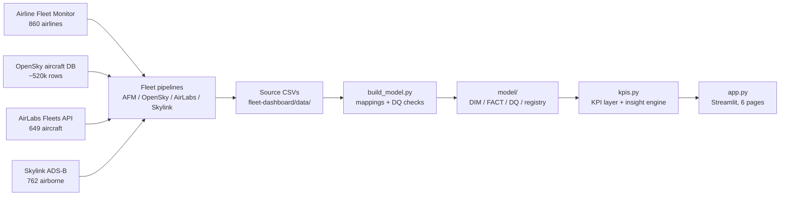

# Global Airline Fleet Intelligence

A production-quality interactive dashboard for airline fleet scale, composition,
age, growth, utilization, manufacturer dependency, and future fleet
commitments — built as an aviation intelligence product, not a fleet-size
visualization. Dark aviation-operations theme, six pages, and a data model
that accepts new airlines and aircraft types without changing the app.

**Live snapshot:** 2026-11-05 · AFM 25,226 active aircraft (860 airlines) ·
OpenSky 41,752 registered aircraft (1,750 operators) · AirLabs 649 aircraft
(partial) · Skylink 762 airborne aircraft.

## Pages

1. **Executive Overview** — fleet ranking, fleet by region, global fleet map,
   body-type mix; growth and order-book panels are explicit N/A placeholders.
2. **Fleet Composition** — manufacturer split (two sources), family ranking,
   body-type distribution, airline × family heatmap, Airbus/Boeing dependency.
3. **Fleet Age & Replacement** — age distribution, renewal profile, average age
   by airline (OpenSky-derived, coverage-gated), GREEN/AMBER/RED flags with
   configurable thresholds; retirements and replacement ratio are N/A.
4. **Future Fleet & Order Book** — entirely N/A by design: no order-book
   source is connected. Every KPI explains what source would unlock it.
5. **Competitive Benchmark** — fleet scale vs fleet age scatter (age-based
   quadrants; growth is N/A), widebody share, manufacturer dependency.
6. **Data Quality & Sources** — 22 data-quality checks with severity, source
   registry, definitions, and model downloads.

## Architecture



## Data model

| Table | Rows | Grain / notes |
|---|---|---|
| `DIM_AIRLINE` | 2,013 | One row per airline (AFM ∪ OpenSky, keyed by ICAO or `operator_key`) |
| `DIM_AIRCRAFT` | 523 | One row per ICAO typecode, with family / manufacturer / body type |
| `FACT_FLEET_SNAPSHOT` | 5,920 | Airline × aircraft-type rows per source, snapshot 2026-11-05 |
| `FACT_AIRCRAFT_ORDER` | 0 | Schema only — no order source connected |
| `FACT_FLEET_HISTORY` | 0 | Schema only — single snapshot, no history |
| `DATA_QUALITY` | 22 | Checks with severity, affected/total counts, detail |
| `SOURCE_REGISTRY` | 6 | Source, date, retrieval date, confidence, record count |

Typecode classification (`build_model.py`): explicit family/manufacturer
maps for the common types, prefix rules for the long tail, and an explicit
`Unknown` fallback that is counted, not hidden. Country → region uses a
documented 6-region aviation grouping.

## Honesty rules (the product's core constraint)

- **Never fabricate.** Anything without a source renders as
  `N/A — Data unavailable` in an amber card, with the reason and the source
  that would unlock it.
- **AFM average age is not used as a headline age**: 549 of 860 AFM rows share
  the site-wide placeholder 11.2. Headline age comes from AirLabs per-aircraft
  ages (10.8 yrs, 337 of 649 with an age) and OpenSky built years (coverage
  31.2% overall; only airlines with ≥50% coverage are ranked).
- **AFM idle/stored are 0 everywhere** — active fleet equals total fleet in
  that source, and the dashboard says so.
- **OpenSky counts are the known-operator subset**: 41,752 of ~520,000
  aircraft have an operator; the rest are excluded, not estimated.
- **AirLabs is a partial snapshot** (649 of ~25k expected; November quota was
  exhausted before the run). Nothing AirLabs runs until the December reset.
- **Actuals and forecasts are separated**: the whole Future Fleet page is
  forecast inputs, and all of them are currently N/A.

## Run locally

```bash
python3 build_model.py            # rebuild the model from ../data/*.csv
python -m streamlit run app.py    # serves on localhost:8501
python -m pytest tests/ -q        # 18 tests: all pages, KPIs, N/A placeholders, weekly history, analytics
```

The Streamlit venv's `streamlit`/`pip` scripts carry a stale shebang from a
renamed venv — always invoke via `python -m streamlit` / `python -m pip`.

## Deploy (Streamlit Community Cloud)

New app (recommended — keeps the existing 4-tab dashboard live):
repo `aviationengineer/FlightRadar`, branch `main`, main file path
`GLOBAL_FLEET_INTELLIGENCE/app.py`. Or replace the live app's main file path
with the new one. Cloud redeploys on push.

## Adding airlines

Add the airline to the AFM pull (or the OpenSky operator list), re-run the
fleet pipelines, copy the new CSVs into `../data/`, re-run
`python3 build_model.py`. The dashboard reads the model files — no app change
is needed. Operators without an ICAO code are keyed by `operator_key`
(e.g. `IATA:SL` for Thai Lion Air).

## Adding aircraft types

If the rule-based classifier gets a new typecode's family, manufacturer or
body type wrong, add it to `FAMILY` / `MFR_EXPLICIT` /
`WIDEBODY_TYPES` / `REGIONAL_TYPES` / `MILITARY_TYPES` /
`BUSINESS_JET_TYPES` in `build_model.py` and re-run the build.

## Refreshing data

Re-run the four fleet pipelines (AFM weekly, OpenSky monthly, AirLabs
monthly, Skylink weekly), copy the new CSVs into `../data/`, re-run
`build_model.py`, redeploy. The `snapshot_date` in the model and the
"Data as of" line in the sidebar update automatically.

## Known limits (see Data Quality page for all 22)

- No order book, fleet history, or utilization source — growth, CAGR,
  orders, deliveries, replacement ratio, utilization are all N/A.
- Skylink covers 10 target airlines only; its manufacturer field is blank
  on 737 of 762 rows (derived from typecode instead).
- AirLabs airline names are blank on all 649 rows; 233 rows have no typecode.
- AFM country field contains non-countries (ALASKA, AVIANCA, DRAGON, S.A.,
  International) and duplicate namings (Russia / Russian Federation).

## Analytics (Google Analytics 4)

The app reports anonymous usage to Google Analytics 4 (GA4) once a
Measurement ID is configured — until then tracking is completely off and
the app behaves exactly as before.

**What is tracked:** a `page_view` when the app loads, plus a
`page_navigation` event (with the page name) whenever the sidebar page
changes. No personal data is sent — no user IDs, no custom dimensions,
nothing that identifies a visitor. GA4 anonymises IP addresses by
default. The injection lives in `analytics.py` (`inject_analytics`,
called once in `app.py` after the page is chosen); tests are in
`tests/test_analytics.py`.

**Setup — property "Streamlit Initiatives" (Property ID 563317959):**
one GA4 property holds all three Streamlit apps, with one web data
stream per app. This app's stream is **Global Airline Fleet
Intelligence** (`global-fleet-intelligence.streamlit.app`) —
Measurement ID **`G-7DDSXWRLNQ`**. (The other two streams: Fleet
Intelligence Dashboard `G-350W7X94ZY`, WestJet Control Tower
`G-CT7F9YCNEZ`.) In Streamlit Cloud, open this app → Manage app →
Settings → Secrets and add:

```
GA_MEASUREMENT_ID = "G-7DDSXWRLNQ"
```

Tracking starts on the next run; remove the secret to switch it off
again. The ID can also be set as the `GA_MEASUREMENT_ID` constant in
`analytics.py`, but secrets are preferred — never commit a real
Measurement ID to the repo. (Measurement IDs are public identifiers
by design, so listing them here as reference is fine.)

Note: Streamlit Cloud's built-in "App analytics" (view counts in the
Cloud dashboard) is separate from Google Analytics; this integration
does not affect it.
